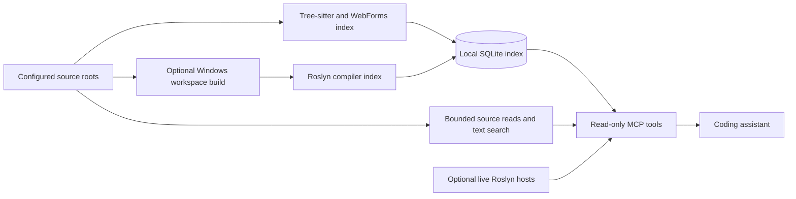

# Dotnet Code Advisor

A read-only [Model Context Protocol](https://modelcontextprotocol.io/) server that
helps coding assistants answer questions about C#, ASP.NET WebForms and JavaScript
from source evidence.

Ask where a symbol is declared, what references it, how a page is wired, or which
API endpoints a call chain can reach. Results identify their evidence layer, source
locations, coverage gaps and ambiguity so the assistant can explain what it verified.

## Why build a code advisor?

Large .NET applications often combine SDK projects, older .NET Framework libraries,
Website Projects without `.csproj` files, generated control fields, and JavaScript.
One analysis method does not cover all of them equally. This project combines a
structural index, compiler analysis and text reads without treating those sources
of evidence as interchangeable.

The query tools cannot edit or execute your application. Building and indexing are
separate, explicit setup steps. The workspace build runs MSBuild and application
build targets, writes build outputs, and should use a dedicated workspace copy.

## Architecture



| Evidence | Meaning |
| --- | --- |
| `roslyn-index` | Persisted compiler results from the indexed build; check build time and project errors. |
| `roslyn` | Results from a loaded compiler workspace. |
| `graph` | Structural, name-based matches; confidence and ambiguity matter. |
| `filesystem` | Source text, without compiler binding. |

An HTTP route match is reported separately from a compiler reference. A migration
twin is a correspondence with evidence, not proof of equivalent behavior.

## Quick start: fictional sample

Requirements: Python 3.12+ and an environment able to install the dependencies.
The graph-only path does not require Visual Studio or a .NET SDK. Commands below
use Windows PowerShell; on macOS/Linux use `.venv/bin/python` and `cp` instead.

```powershell
python -m venv .venv
.\.venv\Scripts\python.exe -m pip install -e ".[dev]"
Copy-Item config.example.toml config.toml
.\.venv\Scripts\python.exe scripts/reindex.py --no-roslyn --allow-missing-controls
.\.venv\Scripts\python.exe scripts/smoke.py
.\.venv\Scripts\python.exe -m dotnet_code_advisor --no-roslyn
```

The last command waits for an MCP client on stdio; silence is expected. The sample
contains a fictional legacy library, WebForms website, JavaScript and modern API.
`--allow-missing-controls` explicitly permits fallback control types for this demo.
For accurate production WebForms control types, generate the reflected control table
as described in [the adaptation guide](docs/ADAPTING.md).

To index your own project, edit the ignored `config.toml`. Paths are resolved relative
to that configuration file. Configure one or both source roots; solutions, compiler
helpers and the primary website are optional. `net48` and `net8` are stable legacy
and modern workspace labels, rather than namespace or directory-name rules.

## Connect an MCP client

Replace the absolute example paths with your local paths:

```json
{
  "mcpServers": {
    "dotnet-code-advisor": {
      "command": "C:/dev/dotnet-code-advisor/.venv/Scripts/python.exe",
      "args": [
        "-m", "dotnet_code_advisor",
        "--config", "C:/dev/dotnet-code-advisor/config.toml",
        "--no-roslyn"
      ]
    }
  }
}
```

Remove `--no-roslyn` when live hosts are configured. The equivalent installed
command is `dotnet-code-advisor`. Review [AGENTS.md](AGENTS.md) for the evidence
and citation rules to give your assistant.

Example prompts:

- “Find `OrderRequest` on both sides and read each declaration.”
- “Show the controls and handlers in `Legacy/Website/Default.aspx`.”
- “What references this symbol? Keep ambiguous and dispatch sites separate.”
- “Which endpoints can this page reach? Report route matches and coverage gaps.”

## Tools

| Tool | Purpose |
| --- | --- |
| `find_symbol` | Locate declarations by name, kind or side. |
| `go_to_definition` | Resolve declaration locations. |
| `find_references` | Find references, with dispatch/candidate sites separated. |
| `find_callers` | Explore inbound call chains. |
| `find_implementations` | Find implementers, derived types and overrides. |
| `get_type_info` | Inspect compiler-resolved type information. |
| `get_dependency_graph` | Explore project or structural type dependencies. |
| `find_dead_code` | Inspect unreferenced members within an explicit scope. |
| `read_file_range` | Read exact source lines within configured roots. |
| `search_text` | Search source text using configured exclusions. |
| `get_control_binding` | Connect markup controls, types and handlers. |
| `get_page_assets` | Inspect master pages, scripts and related assets. |
| `find_migration_twin` | Compare corresponding legacy and modern types. |
| `find_api_calls` | Explore statically reachable HTTP endpoints. |
| `index_status` | Inspect coverage, build state and analysis limitations. |

## Compiler analysis and deployment

Full legacy/WebForms analysis requires Windows, .NET Framework targeting packs,
Visual Studio 2022 Build Tools with web build targets, and the compatible MSBuild
version described in [docs/ADAPTING.md](docs/ADAPTING.md). Modern compiler analysis
also requires the relevant .NET SDK and restored project inputs. Both compiler
hosts and the ASP.NET page-code bridge are provided as source.

For optional HTTP transport:

```powershell
.\.venv\Scripts\python.exe -m dotnet_code_advisor --transport streamable-http --host 127.0.0.1 --port 8400
```

HTTP has no built-in authentication. Keep it local, or put it behind an authenticated
gateway with appropriate transport and host protections. A read-only server can
still disclose source code to its clients.

## Limitations

- Compiler accuracy depends on successful restore/build and reported binding errors.
- Live hosts cover configured solutions; the persisted compiler pass discovers
  projects under configured roots, including ones absent from those solutions.
- JavaScript and reflection dispatch are not compiler-exact C# references.
- Computed HTTP URLs may not link to endpoints. Route matching does not compare hosts.
- HTML, CSS, SQL, configuration and Delphi files are text-searchable without a symbol graph.
- The markup graph uses one configured primary website for application-relative
  paths and global control registrations; the persisted compiler build can discover
  additional Website Projects from solutions.
- Indexes, generated source and logs can contain private source information. Keep
  them private. This project does not anonymize an arbitrary application for publication.

## Development

```powershell
.\.venv\Scripts\python.exe -m pytest
.\.venv\Scripts\python.exe -m build
```

Tests create their own fictional workspaces. Optional compiler tests are documented
in the adaptation guide. The wheel contains the Python server; use the repository
or source distribution for scripts, examples and C# helper sources.

See [docs/VALIDATION.md](docs/VALIDATION.md) for this export's verification results.

## License and commercial use

Release 0.2.0 uses the custom
[Dotnet Code Advisor Monetization-Restricted License](LICENSE).
You may use, modify and share it for free within the license's conditions,
including personal projects and internal company use.

**Selling the advisor or a modified version, or offering its functionality as a
paid hosted service, requires a separate paid commercial license agreed with
the authorized rights holder before that activity begins.** Payment terms are
negotiated; the public license does not set an automatic revenue share.

| Activity | Public license |
| --- | --- |
| Learn, experiment, modify or share a free fork | Allowed, retaining license and notices. |
| Use internally at a company or while developing paid client projects | Allowed if the advisor itself is not supplied as a paid product or service. |
| Sell unrelated software developed using this advisor | Allowed. |
| Sell or bundle the advisor or a modified version in a paid product | Separate paid commercial license required. |
| Offer paid hosted access to its code-advice or analysis functionality | Separate paid commercial license required. |

To request commercial terms, contact the repository owner through the contact
channel on their GitHub profile. The written agreement must identify the authorized
rights holder, permitted use, fee, and payment schedule before commercial use.
See [docs/COMMERCIAL-LICENSING.md](docs/COMMERCIAL-LICENSING.md).

This is **source-available**, rather than OSI-approved open source, because it
restricts monetization. Earlier copies distributed under MIT retain their earlier
permissions; this change governs copies distributed with the new license.
